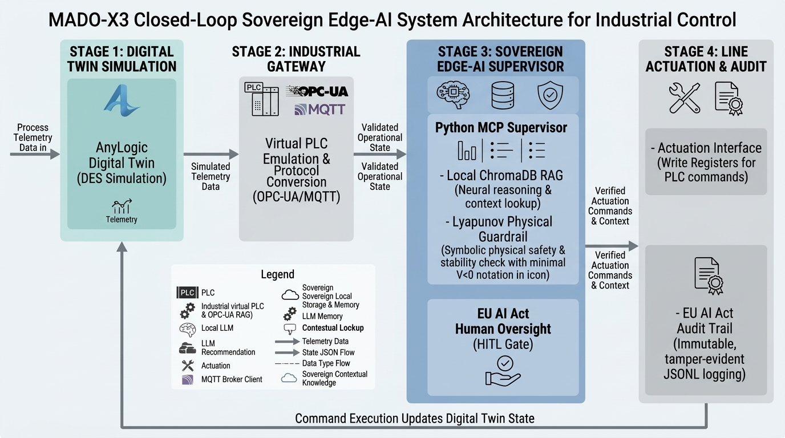

# 🚀 MADO-X3: Scaled Flexible Manufacturing System (FMS) & Lyapunov-Stabilized Digital Twin

<p align="center">
  
</p>

> **Author:** Mohammad Khademi | Dual M.Sc. Research Engineer  
> **Institution:** University of Genoa, Italy  
> **Core Focus:** Industry 5.0, Sovereign Edge-AI, Stochastic Discrete-Event Simulation, & EU AI Act Compliance.

---

## 📊 Executive Visual Summary & Performance Dashboard

| Performance Metric | Nominal State | Stressed / Peak Load | Optimized Target | Compliance Status |
| :--- | :---: | :---: | :---: | :---: |
| **Throughput ($f_1$)** | ~40 parts/hr | Up to 254.84 parts/hr | **Maximized** | ✅ Verified |
| **Specific Energy ($f_2$)** | ~0.230 kWh/p | Peak 0.229 kWh/p | **0.0747 kWh/part** | ✅ Minimized |
| **Lyapunov Stability ($\dot{V}$)** | Stable ($\le 0$) | Controlled Transient | $\dot{V} \le 0$ Recovery | ✅ Guaranteed |
| **Regulatory Audit** | Real-time TX | Event-Driven Logging | Immutable JSONL | **Articles 12–14 Compliant** |

---

## 🏗️ System Architecture & Workflow

The MADO-X3 framework bridges AnyLogic DES event logic with an asynchronous Python supervisor via MQTT and OPC-UA protocols:

```text
[AnyLogic 10-Stage FMS] --(MQTT Telemetry / 1s)--> [FastAPI / Python MCP Bridge]
                                                           │
                                             [Lyapunov & Pareto Optimization]
                                                           │
                                              [Pydantic v2 + Llama 3 SLM]
                                                           │
                                            [ChromaDB RAG Memory Recovery]
